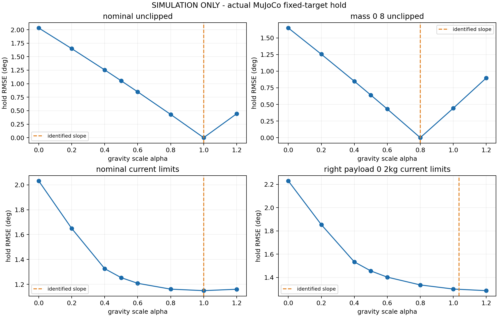

# 无实机重力补偿仿真实验

**所有数据均为仿真，不是实机标定结果。**

每场景采用 20 姿态、每姿态 4 次合成力矩观测，14 姿态拟合、6 姿态留出；再在 6 个留出位置目标上测试 8 个候选、各 3 次真实 MuJoCo 前向动力学保持。每次保持 13 秒，含 10 秒前馈 ramp；统计最后 1 秒。PD 增益按当前 URDF 及 CAN 量化/限幅计算，其中关节 4 配置 kd=40 被编码限制到 5。

| 仿真场景 | 模型比例估计 | 留出力矩 RMSE (Nm) | 最好被测比例 | 保持 RMSE (deg) |
| --- | ---: | ---: | ---: | ---: |
| nominal_unclipped | 0.99999 | 0.00281 | 1.00 | 0.00000 |
| mass_0_8_unclipped | 0.79999 | 0.00281 | 0.80 | 0.00000 |
| nominal_current_limits | 0.99999 | 0.00281 | 1.00 | 1.14916 |
| right_payload_0_2kg_current_limits | 1.03457 | 0.08494 | 1.20 | 1.28670 |

未限幅场景仅为理论对照，不代表应放宽实机限幅。额外右侧负载场景没有唯一已知全局比例；它用于检查单一比例模型的局限。当前限幅场景需要同时查看饱和比例。

本实验不含真实电机摩擦、温度、驱动器反馈误差、总电流限制、手指分支和接触；它验证计算链路和指定模型中的选参方法，不能据此将实机参数直接设为仿真最优值。

完整数值与运行配置见 `results.json`，逐姿态保持结果见 `hold_sweep.csv`，每场景的原始模拟数据、拟合区间及对照表保存在相应子目录。

参考：[MuJoCo 动力学计算文档](https://mujoco.readthedocs.io/en/stable/computation/)。

## 本轮结果解读
- KDL 与 MuJoCo 的模型重力矩最大相对差异为 8.86e-16（20 个测试姿态，重力常数统一为 9.80665 m/s²）。这只验证两种实现的一致性。
- `nominal_unclipped`：比例 0.999991，姿态 bootstrap 95% 区间 [0.999761, 1.000186]。该区间仅反映这里注入的随机测量噪声和姿态采样，不包含真实机器人系统误差。
- `mass_0_8_unclipped`：比例 0.799990，姿态 bootstrap 95% 区间 [0.799761, 0.800185]。该区间仅反映这里注入的随机测量噪声和姿态采样，不包含真实机器人系统误差。
- `nominal_current_limits`：比例 0.999991，姿态 bootstrap 95% 区间 [0.999761, 1.000186]。该区间仅反映这里注入的随机测量噪声和姿态采样，不包含真实机器人系统误差。
- `right_payload_0_2kg_current_limits`：比例 1.034568，姿态 bootstrap 95% 区间 [1.025892, 1.048141]。该区间仅反映这里注入的随机测量噪声和姿态采样，不包含真实机器人系统误差。

当前限幅场景中，比例 0.5 的保持 RMSE 为 1.25350°，比例 1.0 时为 1.14916°。比例 1.0 时约 38.1% 的末段关节采样达到前馈限幅，说明在这些仿真姿态中，调比例的改善空间已受限幅影响。

右臂增加 0.2 kg 负载时，左臂辨识比例约 1.00001，右臂约 1.12054；单一全局比例约 1.03457，留出力矩残差也明显增大。此时应检查载荷模型与左右臂差异。该场景扫描到的最好比例 1.2 位于扫描上界，只能称为所测范围内最好，不能证明是连续全局最优，也不是实机推荐参数。

本轮保存 320 个静态合成观测窗口和 576 个物理仿真保持窗口，原始数据均标记 simulation_only。所有 576 个保持窗口通过末段静态性检查；未启动 ROS 控制器、CAN 或电机。仿真引擎为 MuJoCo 3.8.1。

## 仓库中的结果范围

本目录仅上传汇总报告、曲线、CSV 汇总和源 URDF。896 个原始仿真观测/保持窗口未上传，保存在原开发机 `experiments/gravity_calibration_sim/offline_20261023_full/`，可按仓库根目录操作手册重现。
